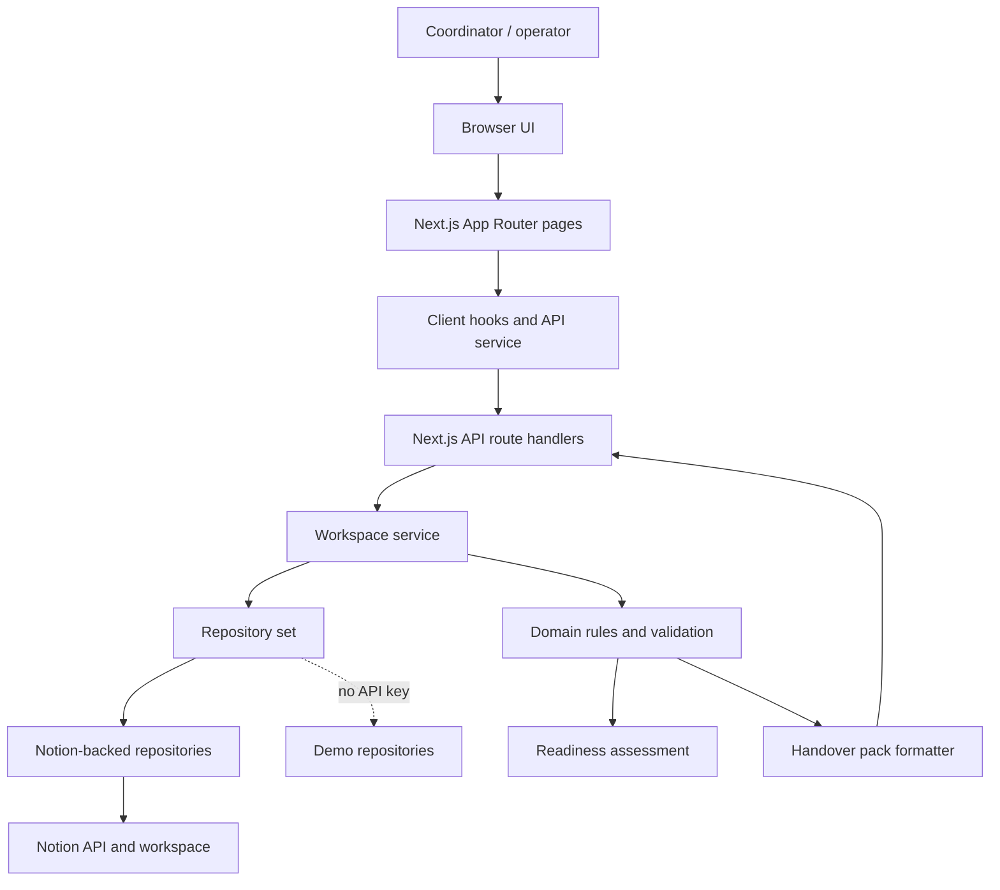
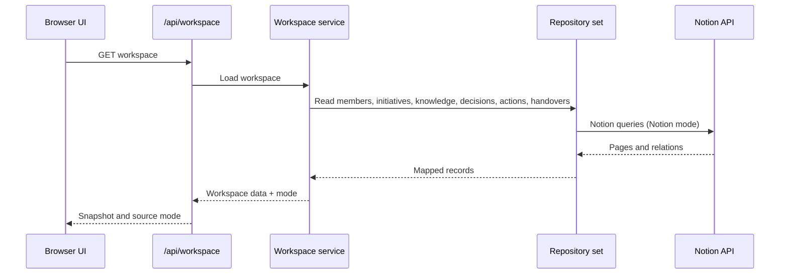
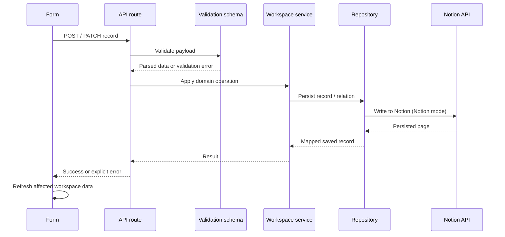

# Levito Architecture

This document describes the current application structure and the principal data flows. It is intended for contributors, maintainers and self-hosters who need to understand where behavior belongs and how the Notion integration is protected.

> **Architecture principle:** the UI presents organizational continuity workflows; domain services decide what those workflows mean; repositories isolate persistence; Notion is the persistent source of truth when live integration mode is enabled.

## 1. System overview

Levito is a Next.js App Router application with server-side route handlers. The browser loads a workspace snapshot and invokes API routes for reads and mutations. The server resolves the active data mode, loads the appropriate repositories and applies validation and domain rules. In Notion mode, the repositories map application records to the six configured Notion data sources.



### Data modes

- **Notion mode:** selected when a Notion API key is configured and the Notion-backed repositories can serve the request. Persistent records are stored in Notion.
- **Demo mode:** selected when no Notion API key is configured. Demo repositories provide sample records for evaluation; these records are not written to Notion.
- **Configured but unavailable:** an invalid token, permission problem or failed Notion request is an error condition. It must not be reported as a successful live connection or silently substituted with demo data for a live operation.

The handover-pack save endpoint adds a server-side guard: it requires Notion mode, reloads the workspace and recalculates readiness before creating the Notion page.

## 2. Repository map

The following is a responsibility-oriented map of the principal folders and files. Individual components may evolve, but responsibilities should remain separated.

```text
app/
  page.tsx                         # application entry
  overview/                        # overview screen
  settings/                        # organization, data-source and policy settings
  initiatives/                      # initiative list and detail routes
  knowledge/                        # Knowledge Library
  decisions/                        # Decision Log
  handovers/                        # Handover Center and handover detail
  api/
    workspace/                      # workspace snapshot
    status/                         # application status
    notion/                         # connection, mapping and repair endpoints
    organization/                   # organization settings
    settings/                       # application settings
    members/                         # member CRUD
    initiatives/                     # initiative CRUD and pack endpoint
    knowledge/                       # knowledge CRUD
    decisions/                       # decision CRUD
    actions/                         # action CRUD
    handovers/                       # handover CRUD and handover-pack endpoint

components/
  shared/                            # reusable layout and form primitives
  initiatives/                       # initiative forms and UI
  knowledge/                         # knowledge forms and UI
  handover/                          # handover forms, detail view and pack dialog

domain/
  handover-pack.ts                   # handover pack composition and Markdown output
  initiative-readiness.ts            # initiative readiness rules

lib/
  client/api-service.ts              # browser-side API client
  hooks/use-workspace.ts             # workspace snapshot and refresh behavior
  services/workspace-service.ts      # workspace orchestration
  validation/schemas.ts              # runtime input schemas
  notion/                             # Notion client, codecs, mappings and config store

scripts/
  notion-setup.ts                    # Notion data-source provisioning
  config-command.ts                  # configuration init / migration / recovery dispatcher
  init-journal.ts                    # create-only local initialization journal

tests/
  domain/                             # domain rules and readiness tests
  notion/                             # mapping, codec, configuration and integration-flow tests
  services/                           # service and refresh workflow tests
  validation/                         # input schema tests
```

The route list and module names above reflect the project structure observed during the current hardening work. Check the source tree before relying on this as an exhaustive listing after future refactors.

## 3. Persistence model

The live Notion workspace contains six Levito-managed data sources.

| Data source | Responsibility | Key relationships |
|---|---|---|
| **Members** | People and committee roles, including active status. | Owners, assignees, outgoing owners and successors. |
| **Initiatives** | Work owned or maintained by the organization. | Owner; related knowledge, decisions, actions and handovers. |
| **Knowledge Library** | SOPs, playbooks, lessons, contacts and templates. | Owner and related initiatives; review date supports readiness. |
| **Decision Log** | Decisions and their context, status, date and outcome. | Related initiatives and handovers. |
| **Handover Actions** | Unfinished or completed work with an assignee, due date, next step and status. | Member assignee, initiative and handover. |
| **Handovers** | Responsibility transitions between terms and people. | Outgoing owner, successor, initiatives, required knowledge, decisions and actions. |

Relations are stored as Notion relations and mapped to application-level record IDs. The handover pack resolves those IDs against the loaded workspace; it should not invent missing owners, documents or decisions to make a pack look complete.

## 4. Main request flows

### Workspace read



The workspace response carries both the records and its data mode. The browser should preserve that mode with the snapshot. If mode is absent or invalid, an export must not guess that the records are demo or live.

### Record mutation



A UI success notification should only follow a confirmed successful mutation. Failed Notion requests should be surfaced as errors; the client must not present a failed write as saved.

## 5. Handover lifecycle

A handover describes one role or responsibility moving from an outgoing owner to an incoming successor.

1. Select the role/responsibility and outgoing/incoming terms.
2. Assign an outgoing owner and a different successor.
3. Select initiatives in scope.
4. Link the knowledge documents and decisions the successor needs.
5. Record unfinished actions, each with an assignee, due date and next step.
6. Have the outgoing owner confirm the initiative/document scope and action-list completeness.
7. Have the successor acknowledge that they have reviewed the current state.
8. Recalculate readiness from persisted workspace records.
9. Preview, copy or save the handover pack.

### Handover readiness policy

The current handover policy has five checks worth 20 points each:

| Check | Evidence required |
|---|---|
| Documented owners | Outgoing owner and owners of all in-scope initiatives are recorded; scope is confirmed. |
| Named successor | An incoming owner is recorded and is distinct from the outgoing owner. |
| Playbooks and SOPs | At least one linked required playbook/SOP has substantive content; the current UI policy uses a 200-character minimum. |
| Review dates | Linked documents have review dates inside the active review window. |
| Open actions | Every unfinished action has an assignee, due date and next step; the outgoing owner confirms the list is complete. |

A criterion that cannot be evaluated is unassessed, not silently passed. Readiness is a measure of documented evidence, not a prediction or guarantee of operational success. Policy version and review window are carried into the generated pack.

## 6. Handover pack generation and provenance

There are two user-facing generation paths:

### Copy as Markdown

The browser builds the pack from its last successfully loaded workspace snapshot. The snapshot's mode must be passed explicitly to the Markdown formatter. This path is not a fresh Notion read at the instant the user clicks Copy; refresh the workspace first when records may have changed.

### Save pack to Notion

The server accepts a handover ID, validates that the request is in Notion mode, reloads the workspace using the resolved Notion-backed repositories, finds the handover by exact ID and recalculates readiness from those records. It then formats the pack and creates the page under the configured root. A missing handover, demo mode or Notion read failure should return an explicit error rather than substituting demo records.

The Markdown source label must be supplied explicitly (`notion` or `demo`). It must never be a hardcoded label or inferred from a connection indicator alone. Keep the date and policy version dynamic. Tests should assert the provenance header for both modes and compare pack content for equivalent snapshots.

The pack includes responsibility, owners, target date, acknowledgement, readiness checks, initiatives in scope, unfinished actions, knowledge documents, contacts and decisions where present. Missing relationships should be represented as missing or reported; they must not be filled with fixture data.

## 7. Notion configuration lifecycle

The configuration page is manually selected and must be a live direct child of `NOTION_ROOT_PAGE_ID`. Levito verifies the page identity and parent before configuration writes. Page IDs supplied to the setup script should be raw IDs, not full URLs.

```mermaid
sequenceDiagram
    participant Operator
    participant CLI as notion:setup
    participant Journal as Local init journal
    participant Store as Config store
    participant N as Notion API
    Operator->>CLI: npm run notion:setup -- --init-config
    CLI->>N: Verify selected configuration page and parent
    CLI->>Journal: Create-only initialization intent
    CLI->>Store: Append versioned candidate
    Store->>N: Append candidate and read it back
    CLI->>N: Append manifest pin and verify exact block
    CLI->>Journal: Create-only verification receipt
    CLI-->>Operator: NOTION_CONFIG_MANIFEST_BLOCK_ID
    Operator->>CLI: Save pin in .env.local; run npm run notion:setup
    CLI->>N: Discover/reuse or create six data sources and relations
    CLI-->>Operator: Setup summary and data-source IDs
```

### Manifest and journal safety

- The manifest pins the active configuration candidate; readers follow the verified pin rather than trusting an arbitrary JSON/code block on the page.
- Initialization appends managed records and verifies the returned block IDs and payloads. It does not delete arbitrary page children.
- The local journal stores a create-only intent and verification receipt for the selected config page. An unresolved intent blocks an automatic retry.
- Keep the journal directory private and persistent on the same host used for initialization.
- If an initialization result is indeterminate, stop and resolve the exact manifest associated with that attempt or choose a fresh configuration page. Do not delete journal files or manually invent a pin.
- V1 migration requires the exact trusted legacy manifest pin; do not run upgrade mode speculatively.
- Provisioning errors after an ambiguous database create or lookup require inspection of the Notion root before retrying.

## 8. Failure behavior

| Condition | Expected behavior |
|---|---|
| No Notion API key | Select demo repositories and clearly identify sample data. Demo writes remain local to the demo mode and are not written to Notion. |
| Invalid token or missing permissions | Surface an explicit connection/read/write error. Do not label the workspace as connected. |
| Notion read fails | Return an error for the requested live operation; do not silently fill the result with demo records. |
| Notion write fails | Do not show a success notification; preserve enough context for the operator to retry safely after verifying whether the write was applied. |
| Handover ID missing during pack save | Return not found; do not generate a pack for a different handover. |
| Pack save requested in demo mode | Reject the operation. |
| Workspace snapshot has no valid mode | Treat its provenance as unknown; do not label an export as live or demo by assumption. |

## 9. Consistency and deployment limits

These constraints are important when operating the current implementation:

- The configuration store serializes relevant writes within one running application process. This does not coordinate multiple application instances or machines.
- Notion does not provide a transactional compare-and-swap mechanism for this workflow. A stale but otherwise well-formed Notion listing may not reveal a concurrent update.
- The initialization journal is local host state. It is not an exactly-once guarantee across hosts, loss of local state or eventual-consistency windows.
- Use one writer for configuration initialization and provisioning. Do not run concurrent setup processes against the same root/configuration page.
- For a multi-instance deployment, add external coordination and test the behavior against Notion's consistency and rate-limit characteristics before claiming distributed-write safety.
- Protect the Notion integration token and limit its access to the workspace pages it needs.

## 10. Testing strategy

The test suite is organized around boundaries and behavior:

- **Codec and mapping tests:** validate Notion page/property conversion and relation mapping.
- **Configuration-store tests:** cover manifests, candidates, revision ordering, initialization and recovery invariants.
- **Domain tests:** exercise member and readiness rules.
- **Validation tests:** reject malformed API inputs.
- **Service tests:** validate workspace orchestration and refresh behavior.
- **Workflow tests:** test handover readiness refresh and pack routes without requiring production Notion writes.

The latest recorded hardening verification on 26 November 2026 reported 113 tests passing across 11 test files, with TypeScript, ESLint and the Next.js production build completing successfully. Re-run all checks after changing code or dependencies.

```bash
npm test
npm run typecheck
npm run lint
npm run build
```

## 11. Engineering conventions

- Keep domain decisions in domain modules or services, not React components.
- Keep Notion-specific shapes and property mapping inside the Notion adapter layer.
- Validate input at API boundaries.
- Make source mode explicit wherever records are exported or persisted.
- Treat relationship IDs as references that must resolve; do not fill missing relationships with plausible-looking mock records.
- Keep mutations narrow and refresh the affected workspace snapshot after a successful write.
- Add tests for failure paths and provenance whenever a data-source boundary changes.
- Prefer small commits grouped by logical behavior.
