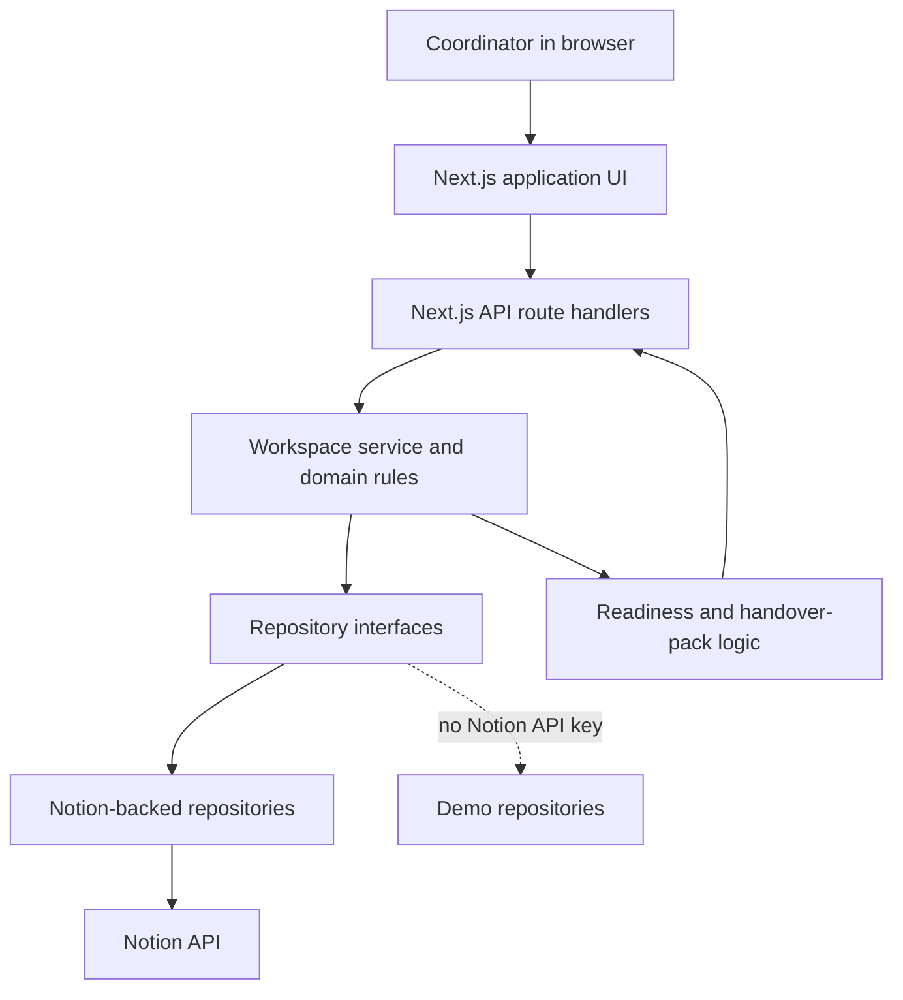

<div align="center">
  
  <h1>Levito</h1>
  <p><strong>Carry institutional knowledge forward.</strong></p>
  <p>A self-hostable continuity workspace for student organizations and rotating committees.</p>

  
  
  
  
  
</div>

---

## What is Levito?

Levito helps a student organization keep operating knowledge when its committee changes. It brings people, initiatives, knowledge documents, decisions, unfinished actions and role handovers into one structured workspace, with Notion serving as the persistent source of truth.

The central idea is simple: a committee should not have to reconstruct how its organization works every time a term ends. Responsibilities should have owners, decisions should retain context, procedures should be reviewable, and unfinished work should have a next step and a person to pick it up.

Levito is designed to be operated by an individual coordinator, outgoing committee lead or organization administrator. That person can maintain the workspace and record the people involved; a Member record does not, by itself, create a separate application login for that person.

## Why it exists

Student organizations repeatedly lose context during committee transitions:

- Important procedures are scattered across personal drives and chat histories.
- New committee members inherit responsibilities without a clear map of current work.
- Decisions survive as outcomes but lose the reasoning behind them.
- Unfinished actions have no clear assignee, due date or next step.
- Handover quality is judged informally, with no visible evidence of what is ready and what is missing.

Levito makes those records explicit and connects them to the responsibilities they support.

## What it does

| Area | Purpose |
|---|---|
| **Organization settings** | Store the organization name, short name, university and current term. |
| **Members** | Maintain committee people, roles, departments and active status. Deactivate former members rather than erasing useful history. |
| **Initiatives** | Track ongoing work, ownership, status, dates and the documents and decisions related to it. |
| **Knowledge Library** | Maintain SOPs, playbooks, lessons, contacts and templates, with owners and review dates. |
| **Decision Log** | Preserve decisions and their context so future committees can understand why something was done. |
| **Handover Actions** | Track unfinished work with an assignee, due date, next step and related initiative or handover. |
| **Handover Center** | Transfer a role from an outgoing owner to a named successor, define scope, attach evidence and record acknowledgement. |
| **Readiness assessment** | Score whether the evidence required for a responsible handover is documented. |
| **Handover pack** | Preview, copy or save a structured Markdown summary of the role, owners, initiatives, actions, knowledge and decisions. |

## How an individual can use Levito

You do not need to start with a large committee rollout. One coordinator can configure the workspace and maintain it for the organization.

1. **Set up the organization.** Enter its name, short name, university and current term in Settings.
2. **Add the people.** Create a Member record for each committee member and assign their role and department. Keep former members as inactive records when they leave.
3. **Create initiatives.** Record the work the committee is responsible for and assign an owner to each in-scope initiative.
4. **Write down how the work is done.** Add SOPs, playbooks, templates and useful contacts to the Knowledge Library. Give documents an owner and review date.
5. **Record important decisions.** Capture the decision, its status, date and outcome so future owners can understand the context.
6. **Track unfinished work.** Add actions with an assignee, due date and concrete next step. Link each action to its initiative and, when relevant, its handover.
7. **Prepare a handover.** Select the role, outgoing owner, successor, terms, target date, initiatives in scope, required documents and decisions to know about.
8. **Confirm the evidence.** Have the outgoing owner confirm the scope and action list. Ask the successor to review the current state and record acknowledgement.
9. **Review readiness and generate the pack.** Resolve the gaps shown by the readiness assessment, then preview or export the handover pack.

A practical first use is to model one role (for example, IT Head), one current initiative, two members (outgoing and incoming), one useful SOP, one decision and any unfinished actions. Generate the pack and ask the successor to review it before treating the transition as complete.

## Handover readiness

Levito's handover policy evaluates five evidence areas, each worth 20 points:

| Check | Evidence expected |
|---|---|
| **Documented owners** | The outgoing owner is recorded and every in-scope initiative has an owner. The outgoing owner also confirms the scope. |
| **Named successor** | A different incoming owner is recorded for the responsibility. |
| **Playbooks and SOPs** | At least one required linked playbook or SOP contains substantive content (the current UI policy uses a 200-character minimum). |
| **Review dates** | Linked documents have review dates inside the configured review window. |
| **Open actions** | Unfinished work has an assignee, due date and next step, and the outgoing owner confirms the action list is complete. |

The score is an evidence-coverage measure, not a guarantee that a transition will succeed. A check that cannot be assessed is treated as unassessed rather than silently counted as a pass. A 100/100 score means the configured evidence checks are met; the people involved must still review the content.

## Architecture at a glance

Levito uses the Next.js App Router for the interface and server-side API routes. The server resolves the active data mode and repositories, applies domain and validation rules, and maps records to the Notion data sources when a Notion integration is configured.



See [ARCHITECTURE.md](ARCHITECTURE.md) for the module map, data model, request flows, configuration lifecycle, failure behavior and operational limits.

## Technology

The currently verified project stack includes:

- **Next.js 16.4.6** — App Router, pages and server-side route handlers.
- **TypeScript** — application, domain and integration code.
- **Notion API** — persistent workspace data source.
- **Zod** — runtime schema validation at data boundaries.
- **Vitest 5.1.0** — unit and workflow tests.
- **ESLint** — static code-quality checks.

The exact dependency versions are defined by the repository's package manifest and lockfile. Treat those files as authoritative if this README and the installed dependencies differ.

## Getting started

### Prerequisites

- Node.js compatible with the Next.js version in this repository.
- npm (and the repository's committed lockfile, if present).
- A Notion workspace where you can create pages and an internal integration.
- Permission to share the selected Notion root page with that integration.

### 1. Install the application

```bash
git clone <your-repository-url>
cd Levito
npm install
```

If the repository contains a committed `package-lock.json`, prefer `npm ci` for a reproducible install.

### 2. Create a Notion integration

1. Create an internal integration in your Notion workspace.
2. Give it the content capabilities required to read, insert and update the pages and databases Levito manages.
3. Create or select a dedicated root page for this Levito workspace (for example, `Levito Sandbox`).
4. Share that root page with the integration.
5. Inside the root page, manually create a child page for configuration (for example, `Levito Configuration`). It must be a **direct child** of the configured root page.
6. Copy the raw page IDs for the root and configuration pages. Use the 32-character ID (hyphens are also accepted); do not paste a full Notion URL into these variables.

Use a disposable test root while evaluating Levito. Do not point a first-time installation at an existing production workspace.

### 3. Configure environment variables

Create `.env.local` from the example file:

**PowerShell (Windows):**

```powershell
Copy-Item .env.example .env.local
notepad .env.local
```

**macOS / Linux:**

```bash
cp .env.example .env.local
```

At minimum, configure the following values. Keep any additional variables already documented in `.env.example`.

```dotenv
NOTION_API_KEY=your_internal_integration_token
NOTION_ROOT_PAGE_ID=your_raw_root_page_id
NOTION_CONFIG_PAGE_ID=your_raw_configuration_page_id
NOTION_CONFIG_MANIFEST_BLOCK_ID=
NOTION_VERSION=2026-03-11
LEVITO_INIT_STATE_DIR=/absolute/path/to/levito/init-state
```

On Windows, create a persistent local journal directory:

```powershell
$journalDir = Join-Path $env:LOCALAPPDATA 'Levito\init-state'
New-Item -ItemType Directory -Force -Path $journalDir | Out-Null
Write-Host $journalDir
```

Copy the printed absolute path into `LEVITO_INIT_STATE_DIR` in `.env.local`. Keep this directory private and persistent on the same machine that runs initialization. Do not place it in a temporary folder or delete it while an initialization attempt may be unresolved.

The Notion API key is a server-side secret. Never prefix it with `NEXT_PUBLIC_`, paste it into an issue or chat, or commit `.env.local`.

### 4. Initialize the configuration manifest

Run this once after the root page, direct-child configuration page, integration access and journal directory have been verified:

```bash
npm run notion:setup -- --init-config
```

The command prints a value similar to:

```dotenv
NOTION_CONFIG_MANIFEST_BLOCK_ID=<generated-manifest-block-id>
```

Copy that exact value into `.env.local` and save the file. Initialization appends and verifies managed configuration records; it is designed not to delete unrelated page content.

**Important:** Initialization uses a create-only local journal. If the command fails or its result is ambiguous, do not blindly run it again or delete journal files. Inspect the configuration page and follow the recovery guidance in [ARCHITECTURE.md](ARCHITECTURE.md) before proceeding. A fresh configuration page may be safer than guessing at recovery.

### 5. Provision the Notion data sources

After the manifest pin has been saved to `.env.local`, run:

```bash
npm run notion:setup
```

The setup command creates or reuses the six Levito databases and configures their relations:

- Members
- Initiatives
- Knowledge Library
- Decision Log
- Handover Actions
- Handovers

It writes the resulting data-source IDs back to `.env.local`. Run provisioning only after a successful initialization. If provisioning stops after an ambiguous create or lookup error, inspect the root page before retrying; an uncertain create can otherwise result in duplicate databases.

### 6. Start Levito

```bash
npm run dev
```

Open [http://localhost:3000](http://localhost:3000).

Go to **Settings → Data source** and verify that the configuration page is reachable and all six data sources show as connected. Restart the development server after changing `.env.local`, because environment variables are loaded when the server starts.

### 7. Verify the installation

Use a small disposable dataset:

- Add two different members (outgoing owner and successor).
- Create one initiative and assign an owner.
- Create one SOP with substantive content and a current review date.
- Add a decision and, if needed, an unfinished action.
- Create a handover linking the members, initiative, document and decision.
- Confirm scope and the action list, then record successor acknowledgement.
- Preview the handover pack and verify its source attribution and contents.

Refresh Levito and inspect the corresponding Notion records to verify persistence and relations.

## Development commands

| Command | Description |
|---|---|
| `npm run dev` | Start the local development server. |
| `npm run build` | Create an optimized production build. |
| `npm run start` | Start the production server after a build. |
| `npm test` | Run the Vitest suite once. |
| `npm run typecheck` | Run TypeScript without emitting files. |
| `npm run lint` | Run ESLint. |
| `npm run notion:setup -- --init-config` | Initialize the configuration manifest (first-time setup). |
| `npm run notion:setup` | Provision or reuse Notion databases and relations. |

### Local validation baseline

The latest verification recorded during the hardening work on **26 November 2026** completed with **113 tests passing across 11 test files**, plus successful typecheck, lint and production build. This is a snapshot, not a live CI badge; rerun the commands above against your checkout before releasing.

## Demo mode and live Notion mode

- When no Notion API key is configured, the application can use demo repositories. Demo records are sample data and are not written to Notion.
- When a Notion integration is configured, workspace operations use the Notion-backed repositories. An invalid token or failed Notion request should be surfaced as an error; it must not be represented as a successful live connection.
- The handover-pack save endpoint validates Notion mode and reloads the workspace on the server before saving. The browser's **Copy as Markdown** action uses the last successfully loaded workspace snapshot, so refresh the workspace before copying if records have changed.

Always confirm the data-source mode in Settings before entering real organization data.

## Security and operational guidance

- Keep `NOTION_API_KEY` server-side and store local secrets in `.env.local`.
- Confirm `.env.local` is ignored by Git (`git check-ignore -v .env.local`).
- Grant the integration access only to the Notion root page and content it needs to manage.
- Use a private, persistent directory for `LEVITO_INIT_STATE_DIR`; it stores initialization intent and verification receipts.
- Use a dedicated test root and test integration before working with real organization records.
- Keep backups of important Notion content and review the generated handover pack before treating it as an authoritative transfer document.

### Current consistency limits

Notion does not provide a transactional compare-and-swap primitive for this configuration workflow. The current in-process write serialization protects concurrent writes within one application process; it is not a distributed lock across multiple application instances. Notion listings can also be stale while still being structurally valid. For configuration initialization and provisioning, use one writer and one persistent journal on the same host. Multi-instance or multi-writer deployments need external coordination and additional operational controls.

The local initialization journal is not an exactly-once guarantee across hosts, state loss or eventual-consistency windows. Preserve it and follow the explicit recovery process if an initialization result is indeterminate.

## Project documentation

- [Architecture and data flows](ARCHITECTURE.md)
- [Environment variable template](.env.example)
- [Project history](README.md) — this file is the user-facing entry point.

## Contributing

Contributions are welcome. Before opening a pull request:

1. Create a focused branch from the project's integration branch.
2. Keep commits scoped to one logical change and use descriptive Conventional Commit messages (for example, `fix(handover): validate successor assignment`).
3. Add or update tests for domain rules, repository mappings and API workflows affected by the change.
4. Run `npm test`, `npm run typecheck`, `npm run lint` and `npm run build`.
5. Do not include `.env.local`, Notion tokens, local journal files or real organization data in commits or screenshots.

For changes involving Notion initialization, migrations, provenance or readiness policy, explain the failure modes and recovery behavior in the pull request.

## License

Add the project's chosen open-source license in a `LICENSE` file before publishing the repository as reusable open-source software. Until a license is present, do not assume that others have permission to copy, modify or redistribute the code.

## Brand note

The Levito mark is an original, abstract figure-skating silhouette created as a personal homage to the elegance and extension of figure skating. The project name and visual direction are not an official logo, portrait, endorsement or affiliation with Isabeau Levito, U.S. Figure Skating or the International Skating Union.
